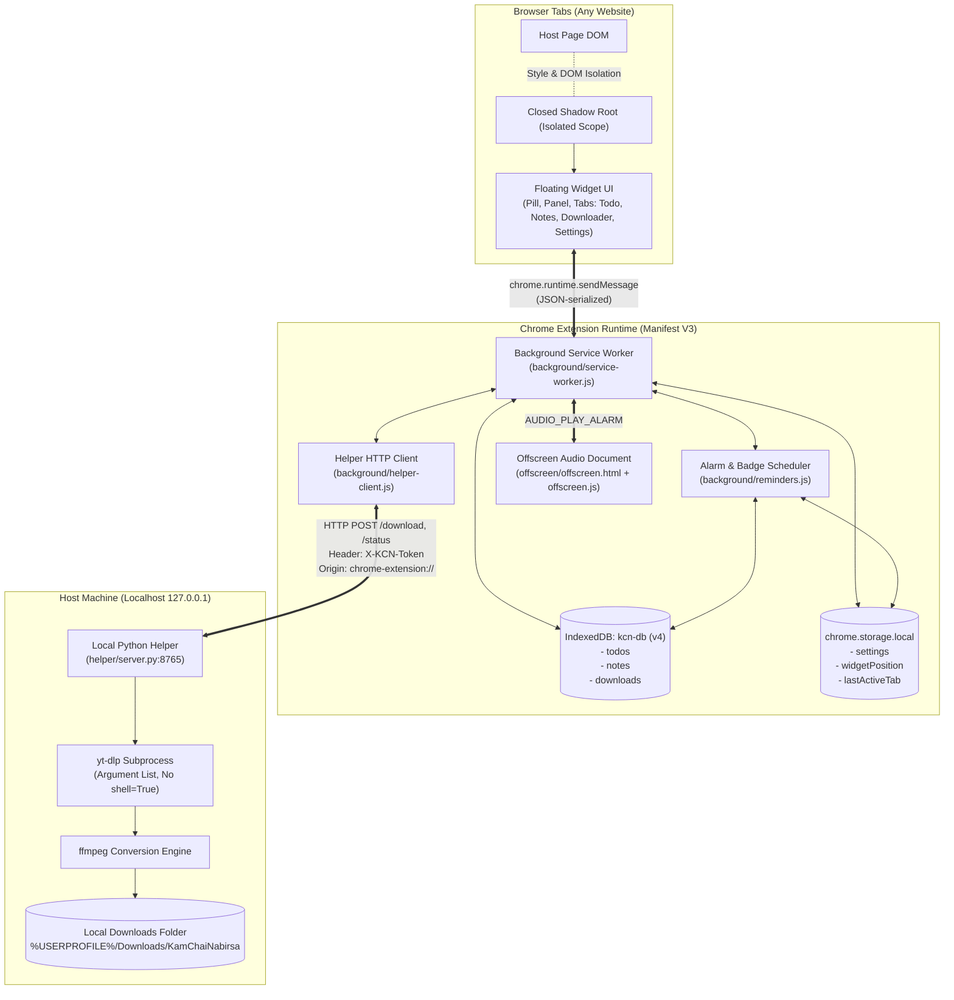

# Kam Chai Nabirsa - Architecture & Security Specification

**Author:** Kushal Parajuli  
**Copyright:** © 2026 Kushal Parajuli  
**Extension Version:** 0.1.0 (Manifest V3)

---

## 1. System Overview

**Kam Chai Nabirsa** ("Don't forget your work") is an offline-first productivity companion built as a Manifest V3 Chrome extension with an optional local Python helper daemon. It integrates four core functional pillars:
1. **Interactive Floating Widget**: Injected into all normal web pages inside an isolated Shadow DOM container with an edge-snapping pill button.
2. **Todo & Alarm System**: Scheduled task management with countdown chips, 5-minute pre-alerts, persistent notification banners, and Web Audio synthesized ringtones via an offscreen document.
3. **Scratchpad & Notes**: Fast text clipping (up to 20,000 characters) and image pasting/dropping (PNG, JPEG, GIF, WEBP up to 10 MB) stored in IndexedDB with in-widget thumbnail generation, pinning, inline editing, and `.txt` file export.
4. **Local Media Downloader**: Communicates via the background service worker with a local Python helper running `yt-dlp` and `ffmpeg` to download user-owned video and audio files with real-time progress tracking.

---

## 2. Component Boundaries & Isolation

### 2.1 Content Script & Shadow DOM Encapsulation
The widget user interface is mounted as a closed Shadow Root on `document.body`:
- **CSS Isolation**: `:host { all: initial; }` guarantees host page styles cannot bleed into the widget, and widget styles cannot leak into the host page.
- **Dynamic CSS Injection**: Styles are bundled in `content/widget-css.js` as an in-memory string assigned to `window.__kcn_css`. This completely eliminates external stylesheet fetches (`<link rel="stylesheet">`) which violate Content Security Policies on strict websites (e.g. GitHub, Claude, YouTube).
- **Z-Index & Positioning**: Fixed position with `z-index: 2147483647` (highest 32-bit signed integer) ensures visibility without interfering with host page layouts.
- **Normal Browser Windows Only**: Before mounting, the widget queries `CHECK_CAN_MOUNT` to ensure it only attaches to normal browser windows, skipping Developer Tools windows, popups, and app frames.

### 2.2 Storage Isolation in Background Service Worker
**Why IndexedDB lives strictly in the Service Worker:**
1. **Origin Isolation**: Web pages run in their own origin (`https://example.com`, etc.). Content scripts sharing that origin would risk exposing user tasks, notes, and downloads to malicious host scripts. Housing IndexedDB inside the background service worker isolates all data to the extension's private origin (`chrome-extension://<extension-id>`).
2. **Cross-Tab Synchronization**: When a todo or note is created or updated in one tab, the service worker broadcasts an update message (`TODOS_CHANGED`, `NOTES_CHANGED`, `DOWNLOADS_CHANGED`) to all tabs, ensuring every open tab reflects immediate updates without reloading.
3. **Lifecycle Persistence**: Tabs open and close frequently; the service worker coordinates alarms, database migrations, and scheduled maintenance independently of active browser tabs.

### 2.3 Offscreen Document Audio Synthesis
Manifest V3 service workers run in headless environments without DOM or Web Audio API access. Furthermore, Chrome's Autoplay Policy strictly blocks unprompted audio playback from background scripts.
- **Solution**: An offscreen document (`offscreen/offscreen.html` and `offscreen.js`) is created with reason `AUDIO_PLAYBACK`.
- **Audio Generation**: Synthesizes a clean 880 Hz PCM square wave beep (200ms sound / 300ms pause) into an in-memory 16-bit WAV audio blob, played via an HTML `<audio loop>` element.
- **Reliability**: Survives audio autoplay restrictions and plays reliably during scheduled alarms.

### 2.4 Local Python Helper Server
Web extensions cannot directly execute system binaries or write arbitrary files to disk.
- The helper (`helper/server.py`) is a lightweight Flask service running on `http://127.0.0.1:8765`.
- Communicates exclusively with the background service worker via authenticated HTTP requests (`X-KCN-Token`).
- Manages background download worker threads with a concurrency queue (`maxConcurrentJobs: 2`), progress reporting, and graceful subprocess cancellation.

---

## 3. Database Schema (IndexedDB `kcn-db` Version 4)

IndexedDB is accessed via promise-based wrappers in `extension/background/db.js`.
> [!IMPORTANT]
> **No Secondary Indexes on Booleans or Nullable Fields**:
> IndexedDB throws a `DataError` when querying indexes on boolean values (`true`/`false`) or `null`/`undefined`. All queries across `todos`, `notes`, and `downloads` use `store.getAll()` or full cursors and filter strictly in JavaScript.

### 3.1 Object Store: `todos` (keyPath: `id`)
| Field | Type | Description |
|---|---|---|
| `id` | `string` (UUID v4) | Primary key |
| `title` | `string` | Task title (sanitized textContent) |
| `done` | `boolean` | Completion status |
| `remindAt` | `number \| null` | Target timestamp (epoch ms) |
| `preReminded`| `boolean` | True if 5-minute pre-alert has fired |
| `reminded` | `boolean` | True if primary alarm has fired |
| `ringing` | `boolean` | True while alarm is actively ringing |
| `ringCount` | `number` | Number of times audio alarm has played |
| `lastRingAt`| `number \| null` | Last audio ring timestamp |
| `snoozedUntil`| `number \| null` | Next snooze alarm target timestamp |
| `createdAt` | `number` | Creation timestamp (epoch ms) |
| `updatedAt` | `number` | Last modified timestamp |

### 3.2 Object Store: `notes` (keyPath: `id`)
| Field | Type | Description |
|---|---|---|
| `id` | `string` (UUID v4) | Primary key |
| `kind` | `'text' \| 'image'` | Note discriminator |
| `text` | `string \| null` | Text note body (max 20,000 characters) |
| `blob` | `Blob \| null` | Raw image binary data (stored as Blob in IDB) |
| `mimeType` | `string \| null` | Image MIME type (`image/png`, `image/jpeg`, etc.) |
| `thumb` | `string \| null` | In-widget canvas thumbnail data URL (max 320px) |
| `fileName` | `string \| null` | Original file name (or generated name) |
| `size` | `number` | Size in bytes (max 10 MB for images) |
| `pinned` | `boolean` | Pinned priority flag (pinned cards sort first) |
| `createdAt` | `number` | Creation timestamp (indexed: `createdAt`) |
| `updatedAt` | `number` | Last update timestamp |

### 3.3 Object Store: `downloads` (keyPath: `id`)
| Field | Type | Description |
|---|---|---|
| `id` | `string` (UUID v4) | Helper job identifier |
| `url` | `string` | Source media URL |
| `type` | `'video' \| 'audio'` | Selected media extraction format |
| `state` | `string` | `'queued' \| 'running' \| 'done' \| 'error' \| 'cancelled'` |
| `progress` | `number` | Download progress percentage (0.0 to 100.0) |
| `filename` | `string \| null` | Final downloaded file name |
| `error` | `string \| null` | Plain-language error description |
| `createdAt` | `number` | Job submission timestamp |
| `updatedAt` | `number` | Last status update timestamp |

### 3.4 Chrome Storage Local: `settings`
Stored under the single key `settings` in `chrome.storage.local`:
- `theme`: `'auto' | 'light' | 'dark'`
- `widgetOpacity`: integer 20 to 100 (default 35)
- `edgeSide`: `'right' | 'left'`
- `widgetSize`: `'small' | 'medium' | 'large'`
- `soundEnabled`: boolean (default true)
- `alarmVolume`: integer 0 to 100 (default 80)
- `ringSeconds`: integer 10 to 300 (default 60)
- `repeatMinutes`: integer 1 to 30 (default 5)
- `maxRepeats`: integer 1 to 20 (default 10)
- `snoozeMinutes`: integer 1 to 60 (default 5)
- `preAlertMinutes`: integer 0 to 30 (default 5; 0 disables pre-alerts)
- `notesAutoDeleteDays`: integer 0 to 365 (default 0 = disabled)
- `lastMaintenanceAt`: epoch ms of last auto-delete sweep
- `helperPort`: integer 1024 to 65535 (default 8765)
- `helperToken`: string (stored securely, excluded from backup JSON exports)

---

## 4. Message Protocol (Widget <-> Service Worker)

All message exchanges use standard JSON-safe envelopes:
- Requests: `{ type: string, payload?: any }`
- Responses: `{ ok: boolean, data?: any, error?: string }`
- Handlers return `true` to indicate asynchronous responses.

| Message Type | Direction | Payload | Description |
|---|---|---|---|
| `TODO_LIST` | Content -> SW | None | Returns all todos sorted by open/completed and time |
| `TODO_ADD` | Content -> SW | `{ title, remindAt }` | Creates a new todo and schedules alarms |
| `TODO_UPDATE` | Content -> SW | `{ id, title, remindAt }`| Updates task title or reminder time |
| `TODO_TOGGLE` | Content -> SW | `{ id }` | Toggles done state; clears/reschedules alarms |
| `TODO_DELETE` | Content -> SW | `{ id }` | Deletes task and cancels associated alarms |
| `TODO_CLEAR_DONE`| Content -> SW | None | Deletes all completed tasks in one transaction |
| `ALARM_STATUS` | Content -> SW | None | Checks for currently ringing tasks |
| `ALARM_STOP` | Content -> SW | `{ id }` | Silences ringing audio; keeps banner pinned |
| `ALARM_SNOOZE` | Content -> SW | `{ id }` | Silences audio and reschedules in N minutes |
| `ALARM_DONE` | Content -> SW | `{ id }` | Silences audio and marks task completed |
| `NOTE_LIST` | Content -> SW | None | Returns note metadata + thumbnails (no binary Blobs) |
| `NOTE_ADD` | Content -> SW | `{ kind, text, dataUrl, thumb, ... }` | Adds text or image note |
| `NOTE_UPDATE` | Content -> SW | `{ id, text }` | Edits text note content |
| `NOTE_DELETE` | Content -> SW | `{ id }` | Removes note |
| `NOTE_PIN` | Content -> SW | `{ id, pinned }` | Updates note pinned status |
| `NOTES_CLEAR` | Content -> SW | `{ alsoDeletePinned }` | Clears notes |
| `NOTE_GET_FULL` | Content -> SW | `{ id }` | Fetches full image as base64 data URL |
| `HELPER_PING` | Content -> SW | None | Probes helper `/ping` and `/auth-check` |
| `DOWNLOAD_START`| Content -> SW | `{ url, type }` | Validates URL and dispatches download job |
| `DOWNLOAD_STATUS`| Content -> SW| `{ jobId }` | Queries job state and progress percentage |
| `DOWNLOAD_CANCEL`| Content -> SW| `{ jobId }` | Cancels queued or running job |
| `DOWNLOAD_LIST` | Content -> SW | None | Retrieves recent downloads (max 20) |
| `DOWNLOAD_CLEAR`| Content -> SW | None | Clears download history |
| `DOWNLOAD_OPEN_FOLDER`| Content -> SW | None | Requests helper to open output folder |
| `SETTINGS_GET` | Content -> SW | None | Reads settings |
| `SETTINGS_SET` | Content -> SW | `{ settings }` | Saves settings and broadcasts changes |
| `SETTINGS_BACKUP_EXPORT` | Content -> SW | None | Generates JSON backup (omits token) |
| `SETTINGS_BACKUP_IMPORT` | Content -> SW | `{ json, mode }` | Restores database from backup JSON |
| `TODOS_CHANGED` | SW -> All Tabs | None | Broadcast notifying tabs to re-render todos |
| `NOTES_CHANGED` | SW -> All Tabs | None | Broadcast notifying tabs to re-render notes |
| `DOWNLOADS_CHANGED` | SW -> All Tabs | None | Broadcast notifying tabs to refresh downloads |
| `SETTINGS_CHANGED` | SW -> All Tabs | None | Broadcast notifying tabs to apply new settings |
| `ALARM_RINGING` | SW -> All Tabs | `{ todo, isMissed }` | Auto-opens widget and displays alarm banner |
| `PRE_ALERT` | SW -> All Tabs | `{ todo }` | Displays 5-minute warning toast |

---

## 5. Chrome Manifest Permissions Justification

| Permission | Technical Requirement & Justification |
|---|---|
| `storage` | Required to persist user settings, window positions, active tabs, and helper auth token across browser sessions via `chrome.storage.local`. |
| `alarms` | Required to schedule exact reminder alerts (`todo:<id>`), 5-minute pre-alerts (`pre:<id>`), alarm timeout stops (`stop:<id>`), repeating rings (`repeat:<id>`), and daily maintenance tasks (`maintenance`). |
| `notifications` | Required to show native desktop notifications for reminders (with interactive Snooze and Done buttons) and quiet notifications when background media downloads complete or fail. |
| `offscreen` | Required to create an offscreen audio playback document (`offscreen/offscreen.html`) to synthesize WAV ringtones without autoplay policy violations. |
| `unlimitedStorage`| Required to prevent IndexedDB storage eviction for image notes (up to 10 MB each) and persistent task/download histories. |
| `scripting` | Required by the service worker to programmatically inject the widget content scripts into all open tabs upon extension installation and update without requiring manual page refreshes. |
| `tabs` | Required to query open browser tabs and windows to target programmatic script injection exclusively to normal browser windows. |
| `http://127.0.0.1/*` | Host permission required for the background service worker to communicate with the local Python helper server on `127.0.0.1:8765`. |
| `<all_urls>` | Host permission required to inject the content script widget into web pages across the web (`http://`, `https://`, `file:///`). |

---

## 6. Security Model & Defensive Design

### 6.1 DOM & XSS Defense
- **Zero `innerHTML` for User Data**: All user-provided strings (todo titles, note text, URLs, file names, error messages) are set exclusively using `element.textContent = ...` or `document.createTextNode(...)`.
- **SVG Image Rejection**: SVG images are strictly rejected during image note uploads. SVGs can contain embedded XML scripts (`<script>`) and malicious event handlers; only raster images (`image/png`, `image/jpeg`, `image/gif`, `image/webp`) are permitted.
- **Content Security Policy**: Manifest V3 default CSP prohibits `eval()`, `new Function()`, and inline scripts.

### 6.2 Local Helper Security Architecture
1. **Loopback Binding Only**: The helper explicitly binds to `HOST = "127.0.0.1"`. It never binds to `0.0.0.0` or public network interfaces.
2. **Timing-Attack Resistant Authentication**: Every request except `/ping` requires the `X-KCN-Token` header. Tokens are compared using `hmac.compare_digest(token, AUTH_TOKEN)` to eliminate side-channel timing attacks.
3. **CORS Origin Lockdown**: Preflight `OPTIONS` and cross-origin checks validate that the `Origin` header matches the extension ID or begins with `chrome-extension://`. Arbitrary web origins are rejected.
4. **URL Validation & SSRF Prevention**:
   - Must start with `http://` or `https://`
   - Max length 2048 characters
   - Cannot start with `-` (prevents command flag injection)
   - Rejects loopback addresses (`127.0.0.1`, `localhost`)
   - Rejects private IP addresses (`10.0.0.0/8`, `172.16.0.0/12`, `192.168.0.0/16`) to prevent intranet SSRF
   - Rejects non-HTTP schemes (`file:`, `javascript:`, `chrome:`, `ftp:`)
5. **Safe Subprocess Execution**:
   - `subprocess.Popen` is invoked with an explicit argument list `[binary, ...flags, '--', url]`.
   - Never uses `shell=True`.
   - Never constructs commands via string concatenation or formatting.
   - The `--` delimiter immediately precedes the target URL to ensure `yt-dlp` cannot interpret URLs beginning with a hyphen as command line flags.
6. **Secret Hygiene**:
   - `helper/token.txt` and `helper/config.json` are git-ignored and never committed to version control.
   - The token is never exposed in logs or console output.
   - JSON backup exports strictly strip `helperToken` to prevent accidental credential leakage when sharing backups.
